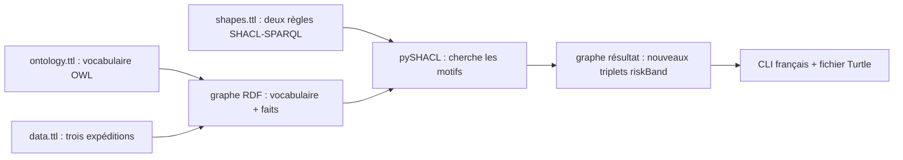

# Lire la démo pas à pas

Ce parcours n'exige aucune connaissance préalable de l'ontologie, de RDF ou des moteurs de règles. Il suit une seule question : **qu'est-ce qu'une règle ajoute au graphe pour une expédition dont le retard est connu ?** Les mots techniques sont définis dans le [glossaire](glossaire.md).

## 1. Le petit problème métier

Nous avons trois expéditions destinées au même magasin : une à l'heure, une avec deux jours de retard et une avec trois jours. Pour apprendre à écrire des règles, nous illustrons le classement suivant :

| Expédition | Retard connu | Résultat calculé par le POC |
|---|---:|---|
| `shipment_on_time` | 0 jour | aucune bande calculée |
| `shipment_watch` | 2 jours | « à surveiller » |
| `shipment_urgent` | 3 jours | « urgent » |

Ces seuils sont inventés pour apprendre ; ils ne constituent pas une politique retail prête à déployer.

## 2. Le chemin suivi par les données



- `ontology.ttl` nomme les types de choses et leurs propriétés : deux classes, une relation entre expédition et magasin, et deux propriétés de données.
- `data.ttl` contient les faits fournis au départ. Le programme charge aussi les déclarations de l'ontologie dans le graphe qu'il transmet à pySHACL.
- `shapes.ttl` indique à quelles expéditions appliquer les règles et contient leurs conditions et résultats.
- RDFLib lit et manipule les graphes RDF ; pySHACL traite les règles SHACL-SPARQL activées par `advanced=True`.
- Le graphe rendu par pySHACL contient les faits de départ et les faits ajoutés ; le CLI les affiche et écrit le graphe en Turtle.

## 3. Lire un premier triplet

Dans `rdf/data.ttl`, la ligne `ex:delayDays 2` exprime un fait sur l'expédition courante. En forme développée :

```text
sujet : shipment_watch
prédicat : delayDays (jours de retard)
objet : 2
```

Un triplet se lit donc « l'expédition `shipment_watch` a 2 jours de retard ». Le mot `objet` désigne ici la troisième position du triplet, pas une classe métier. La relation avec le magasin s'écrit elle aussi en triplet :

```text
shipment_watch — deliveredTo — store_main
```

`deliveredTo` relie deux ressources : c'est pourquoi l'ontologie la déclare propriété objet. `delayDays` relie l'expédition à un nombre : c'est une propriété de données.

## 4. Lire le vocabulaire OWL

Dans `rdf/ontology.ttl` :

- `Shipment` et `Store` sont des **classes**, c'est-à-dire des catégories.
- `shipment_watch`, `shipment_on_time`, `shipment_urgent` et `store_main` sont des **individus**, c'est-à-dire des exemples concrets.
- `deliveredTo` relie deux individus (une expédition à un magasin).
- `delayDays` donne le nombre de jours de retard.
- `riskBand` est la propriété où l'on rangera la catégorie calculée (« bande de risque »).

Les `rdfs:label` et `rdfs:comment` donnent des noms et explications en français. Le domaine et la portée documentent le type attendu des sujets et valeurs. Le POC ne lance pas de raisonneur OWL : il ne faut donc pas conclure que les règles de seuil sont exécutées par OWL.

## 5. Traduire les deux règles

### Règle 1 — retard à surveiller

En français courant : « Pour chaque expédition dont on connaît le nombre de jours de retard, si ce nombre est supérieur à zéro et inférieur à trois, ajouter la bande “à surveiller”. »

La règle dans `rdf/shapes.ttl` est une requête SPARQL `CONSTRUCT` attachée à une forme SHACL :

```sparql
CONSTRUCT {
    $this <https://example.org/retail#riskBand> "à surveiller"@fr .
}
WHERE {
    $this <https://example.org/retail#delayDays> ?days .
    FILTER (?days > 0 && ?days < 3)
}
```

- `$this` est l'expédition examinée.
- Le motif `delayDays ?days` cherche le nombre connu pour cette expédition.
- `FILTER` compare ce nombre aux seuils.
- Si le filtre est vrai, `CONSTRUCT` crée le triplet avec `riskBand` et le texte français `"à surveiller"@fr`.

### Règle 2 — retard urgent

En français courant : « Si l'expédition a au moins trois jours de retard, ajouter la bande “urgent”. » La règle utilise le même motif de retard, mais son filtre est `?days >= 3` et son résultat est `riskBand "urgent"@fr`.

Les **SHACL Advanced Features** sont les fonctionnalités avancées de SHACL qui décrivent notamment ces règles. pySHACL ne les active que parce que le code appelle `shacl_rules(..., advanced=True)`. SHACL-AF est une Working Group Note, pas une Recommendation W3C ; voir le [glossaire](glossaire.md#shacl-advanced-features-shacl-af) pour les statuts.

## 6. Faire le calcul soi-même

1. Pour `shipment_on_time`, `$this` est `shipment_on_time` et `?days` vaut 0. `0 > 0` est faux ; la première règle ne crée rien. `0 >= 3` est faux ; la seconde ne crée rien.
2. Pour `shipment_watch`, `?days` vaut 2. `2 > 0` et `2 < 3` sont vrais ; le graphe reçoit :

   ```text
   shipment_watch — riskBand — "à surveiller"@fr
   ```

3. Pour `shipment_urgent`, `?days` vaut 3. La première condition `?days < 3` est fausse ; la deuxième condition `3 >= 3` est vraie. Le graphe reçoit :

   ```text
   shipment_urgent — riskBand — "urgent"@fr
   ```

Quand aucun triplet `riskBand` n'est créé pour le retard nul, cela signifie seulement que ces deux règles n'ont rien calculé. Cela ne prouve pas que toutes les interprétations possibles de « aucun risque » sont vraies.

## 7. Exécuter le POC

Depuis la racine du projet, avec l'environnement virtuel activé :

```bash
python -m retail_owl_shacl_poc
```

Le CLI annonce les conditions des deux règles, précise ce qu'est un triplet et traduit `riskBand` par « bande de risque ». Il montre ensuite les deux triplets ajoutés et le chemin du fichier `artifacts/retail-logistics-result.ttl`. Ouvrir ce fichier avec un éditeur de texte pour retrouver les faits sous forme Turtle.

## 8. Vérifier en changeant une donnée

1. Dans `rdf/data.ttl`, remplacer temporairement `ex:delayDays 2` par `ex:delayDays 3` pour `shipment_watch`.
2. Lancer `python -m retail_owl_shacl_poc`.
3. Observer que `shipment_watch` reçoit désormais `urgent` au lieu de « à surveiller ».
4. Remettre la valeur 2 et relancer pour revenir au résultat d'origine.

Cela montre le lien entre le fait d'entrée, le filtre numérique et le triplet créé.

## 9. Pourquoi SHACL-SPARQL ici et pas SWRL ?

OWL 2 décrit le vocabulaire et les axiomes de l'ontologie. **SWRL** est une Member Submission du W3C pour écrire des règles liées à OWL, pas une Recommendation.[10]

Le POC n'évalue aucun moteur SWRL : après l'arbitrage de stack, il exécute seulement les règles SHACL-SPARQL.

pySHACL 0.40.1 déclare Apache-2.0 (voir les métadonnées de la version et le texte de licence).[19][11]

RDFLib 7.6.0 déclare BSD-3-Clause (métadonnées de la version et licence du projet).[20][17]

OWL-RL 7.6.2 déclare la notice logicielle W3C, à conserver.[21][13]

L'audit local des 14 paquets installés n'a trouvé aucune déclaration GPL/AGPL.

Les licences retenues ne prévoient pas de redevance de licence, sous réserve de respecter les notices.[11][13][17]

L'inventaire et les limites sont détaillés dans [`LICENSES.md`](../LICENSES.md).

| Approche | Ce qu'elle ferait ici | Limite / statut |
|---|---|---|
| SHACL-SPARQL — exécuté | Calculer et ajouter `riskBand` au graphe | Requiert le support des règles SHACL-AF dans le moteur ; SHACL Core est une Recommendation et SHACL-AF une Working Group Note.[1][2] |
| SWRL — présenté, non exécuté | Exprimer des règles liées aux classes et propriétés OWL | W3C Member Submission, pas une Recommendation. Moteur et licence à choisir séparément.[10] |
| SPARQL `CONSTRUCT` — alternative | Construire les mêmes triplets sans forme/cible SHACL | Plus direct, mais la portée de la règle est moins clairement séparée en une forme. SPARQL 1.1 est une Recommendation.[7] |
| OWL 2 RL / OWL-RL — bibliothèque présente, inférence non appelée | Déduire les conséquences prévues par le profil OWL 2 RL | Ne remplace pas les règles métier numériques de seuil dans ce scénario.[6][21] |
| RuleML — présenté, non exécuté | Représenter/échanger des règles | Ce n'est pas, à lui seul, le moteur qui exécute les règles. |

Les statuts W3C et les licences sont des critères différents : une Recommendation n'implique pas qu'un moteur donné soit libre ou gratuit, et une licence libre n'implique pas que le langage ait le statut Recommendation.

## 10. Où apprendre les termes

Voir [Glossaire de départ](glossaire.md) pour les définitions de triplet, classe, individu, propriété objet, propriété de données, SHACL-AF, SWRL, RuleML et licence sans redevance.

## Sources

[1] https://www.w3.org/TR/shacl
[2] https://www.w3.org/TR/shacl-af
[6] https://www.w3.org/TR/owl2-profiles
[7] https://www.w3.org/TR/sparql11-query
[10] https://www.w3.org/submissions/SWRL
[11] https://www.apache.org/licenses/LICENSE-2.0.html
[13] https://github.com/RDFLib/OWL-RL/blob/master/LICENSE.txt
[17] https://github.com/RDFLib/rdflib/blob/main/LICENSE
[19] https://pypi.org/project/pyshacl/0.40.1
[20] https://pypi.org/project/rdflib/7.6.0
[21] https://pypi.org/project/owlrl/7.6.2
