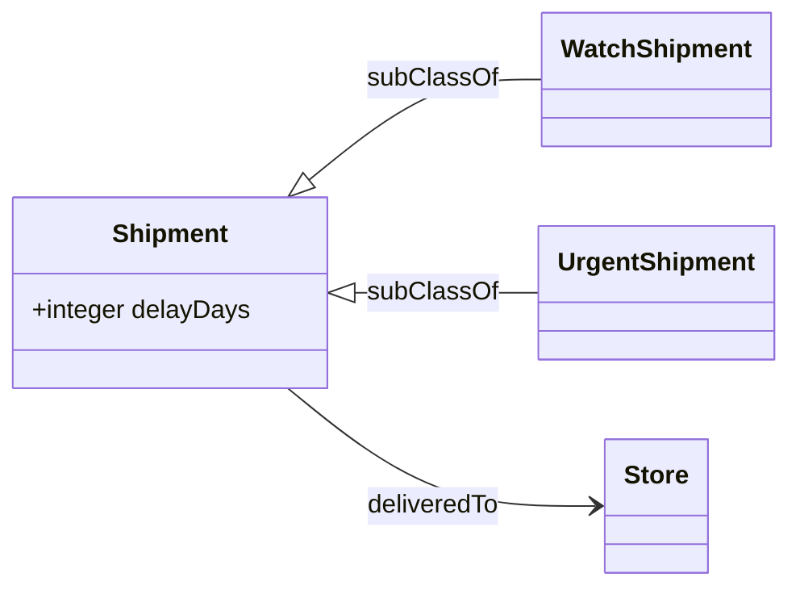
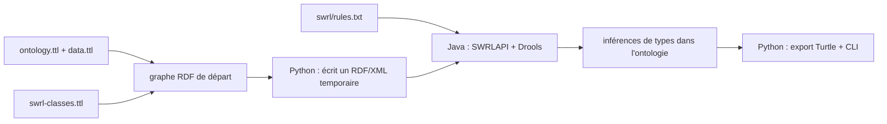

# Découvrir SWRL avec le POC retail

Ce guide ajoute une deuxième démonstration **sans remplacer la première**. La commande habituelle continue d'exécuter les règles SHACL-SPARQL. Cette page explique la commande SWRL facultative, son moteur, ses résultats et ses limites.

## 1. Avant de commencer

La commande SWRL a besoin d'un JDK 11 ou plus récent (`java` et `javac`) et de Maven. L'API SWRLAPI s'appuie sur un moteur séparé ; le moteur Drools publié pour SWRLAPI fournit des règles SWRL ainsi qu'un raisonneur OWL 2 RL.[42][60]

Depuis la racine du projet, après l'installation Python indiquée dans le [README](../README.md) :

```bash
python -m retail_owl_shacl_poc.swrl_demo
```

Au premier lancement, Maven peut télécharger les bibliothèques Java épinglées. Le résultat lisible est écrit dans `artifacts/retail-swrl-result.ttl`. Pour choisir un autre emplacement :

```bash
python -m retail_owl_shacl_poc.swrl_demo --output /chemin/vers/mon-resultat.ttl
```

Les sources des deux démonstrations restent séparées : la commande SHACL n'a pas besoin du JDK et ne lance jamais le moteur SWRL.

## 2. Le vocabulaire partagé et l'extension SWRL

La démo SWRL reprend les mêmes expéditions et les mêmes retards dans `rdf/ontology.ttl` et `rdf/data.ttl`. Elle ajoute deux classes dans `rdf/swrl-classes.ttl` :

- `WatchShipment` — expédition dont le retard est à surveiller ;
- `UrgentShipment` — expédition avec retard urgent.

Ces deux classes sont déclarées comme sous-classes de `Shipment`. Cette extension n'est chargée que par la démo SWRL : le vocabulaire existant de la démo SHACL n'est pas modifié.



À la fin, les deux démonstrations ne produisent pas le même genre de fait :

```text
SHACL : shipment_watch — riskBand — "à surveiller"@fr
SWRL  : shipment_watch — rdf:type — WatchShipment
```

Dans la seconde ligne, `rdf:type` signifie « est un membre de cette classe ». Le résultat SWRL n'est donc pas la valeur texte `riskBand` calculée par SHACL.

## 3. Lire une règle SWRL

Les expressions réellement exécutées se trouvent dans `swrl/rules.txt` :

```text
watch|ex:Shipment(?s) ^ ex:delayDays(?s, ?days) ^ swrlb:greaterThan(?days, 0) ^ swrlb:lessThan(?days, 3) -> ex:WatchShipment(?s)
urgent|ex:Shipment(?s) ^ ex:delayDays(?s, ?days) ^ swrlb:greaterThanOrEqual(?days, 3) -> ex:UrgentShipment(?s)
```

Le texte `watch|` et `urgent|` donne seulement un nom lisible à chaque règle pour le programme Java. L'expression après `|` est la règle SWRL que l'API analyse et exécute.

Une règle se lit **SI tout ce qui est à gauche est vrai, ALORS ajouter la conclusion à droite** :

| Morceau | Explication simple |
|---|---|
| `ex:Shipment(?s)` | `?s` est un individu connu comme expédition. |
| `ex:delayDays(?s, ?days)` | `?days` prend la valeur de retard associée à cette expédition. |
| `^` | « ET » : tous les morceaux du corps doivent correspondre. |
| `swrlb:greaterThan(?days, 0)` | le retard doit être strictement supérieur à 0. `swrlb:` désigne ici une comparaison prédéfinie du langage. |
| `swrlb:lessThan(?days, 3)` | le retard doit également être strictement inférieur à 3. |
| `->` | sépare les conditions (« SI ») de la conclusion (« ALORS »). |
| `ex:WatchShipment(?s)` | conclure que cette expédition appartient à la classe « à surveiller ». |

`?s` et `?days` sont des **variables** : elles désignent des valeurs à trouver, pas des noms d'expédition écrits à l'avance. Un **atome** est un morceau de condition ou de conclusion comme `Shipment(?s)` ou `delayDays(?s, ?days)`. Les fonctions `greaterThan`, `lessThan` et `greaterThanOrEqual` sont des **built-ins** — des comparaisons prédéfinies.

## 4. Suivre les trois expéditions

Les entrées de départ et les seuils sont les mêmes que dans la démo SHACL :

| Expédition | Valeur de `?days` | Comparaison de la règle | Conclusion SWRL |
|---|---:|---|---|
| `shipment_on_time` | 0 | `0 > 0` est faux ; `0 >= 3` est faux | aucune classe de risque ajoutée |
| `shipment_watch` | 2 | `2 > 0` et `2 < 3` sont vrais | `WatchShipment(shipment_watch)` |
| `shipment_urgent` | 3 | `3 < 3` est faux ; `3 >= 3` est vrai | `UrgentShipment(shipment_urgent)` |

Par exemple, la première règle lie `?s` à `shipment_watch` et `?days` à `2`. Tous les atomes du corps sont alors vrais ; le moteur ajoute l'appartenance à `WatchShipment`. Pour un retard de 3 jours, le test `?days < 3` échoue et c'est la deuxième règle qui conclut `UrgentShipment`.

L'absence de classe de risque pour `shipment_on_time` signifie seulement que ces deux règles n'ont rien inféré. Elle ne constitue pas une preuve générale que cette expédition ne présente aucun risque.

## 5. Comment le programme exécute ces règles



1. `retail_owl_shacl_poc/swrl_demo.py` charge le vocabulaire et les faits, mais **ne charge pas** `rdf/shapes.ttl` et n'appelle pas pySHACL.
2. Python sérialise le graphe source en RDF/XML temporaire, format accepté par l'API Java utilisée ici.
3. `swrl-engine/src/main/java/org/kekhermes/retail/SWRLDemo.java` charge l'ontologie avec OWLAPI, lit les deux expressions de `swrl/rules.txt`, puis appelle `SWRLRuleEngine.infer()`. L'interface SWRLAPI décrit cette opération comme le chargement des faits et des règles, leur exécution et la réécriture des connaissances inférées dans l'ontologie.[44]
4. Java écrit l'ontologie enrichie en RDF/XML ; Python la relit et écrit le fichier Turtle de résultat.

L'artefact Maven `swrlapi-drools-engine` 2.1.2 et l'exemple SWRLAPI correspondant montrent l'intégration Java et le choix explicite de cette version dans le POC.[46][48]

## 6. Ce que cette démonstration ne prétend pas faire

- **SWRL n'a pas le statut d'une Recommendation W3C.** La proposition SWRL est une Member Submission ; ce statut documentaire est distinct de la licence d'un moteur.[10]
- **Le moteur n'est pas un raisonneur général OWL 2 DL.** Le moteur Drools de SWRLAPI se présente comme un moteur de règles SWRL et un raisonneur du profil OWL 2 RL ; ses capacités et ses built-ins restent celles de l'implémentation retenue.[60]
- **Les deux moteurs ne sont pas interchangeables.** SHACL-SPARQL ajoute ici une propriété `riskBand`; SWRL infère ici un type de classe. Un jeu de règles métier équivalent peut être exprimé différemment dans chaque approche.
- **La démonstration utilise seulement les comparaisons numériques montrées dans le fichier.** Si vous ajoutez un autre built-in ou une autre dépendance, vérifiez sa prise en charge par le moteur puis refaites l'audit de licences de `LICENSES.md`.
- **La pile Java est optionnelle.** Une erreur Maven n'empêche pas d'utiliser la commande SHACL existante ; consultez le message d'erreur et vérifiez le JDK, Maven et l'accès Maven Central au premier lancement.

Pour les licences, les dépendances transitives et la notice de MXParser, consultez [`LICENSES.md`](../LICENSES.md) et [`swrl-engine/NOTICE.md`](../swrl-engine/NOTICE.md).

## Sources

[10] https://www.w3.org/submissions/SWRL
[42] https://github.com/protegeproject/swrlapi-drools-engine
[44] https://github.com/protegeproject/swrlapi/blob/master/src/main/java/org/swrlapi/core/SWRLRuleEngine.java
[46] https://central.sonatype.com/artifact/edu.stanford.swrl/swrlapi-drools-engine/2.1.2
[48] https://raw.githubusercontent.com/protegeproject/swrlapi-example/release-2.1.2/pom.xml
[60] https://github.com/protegeproject/swrlapi-drools-engine/blob/master/README.md
